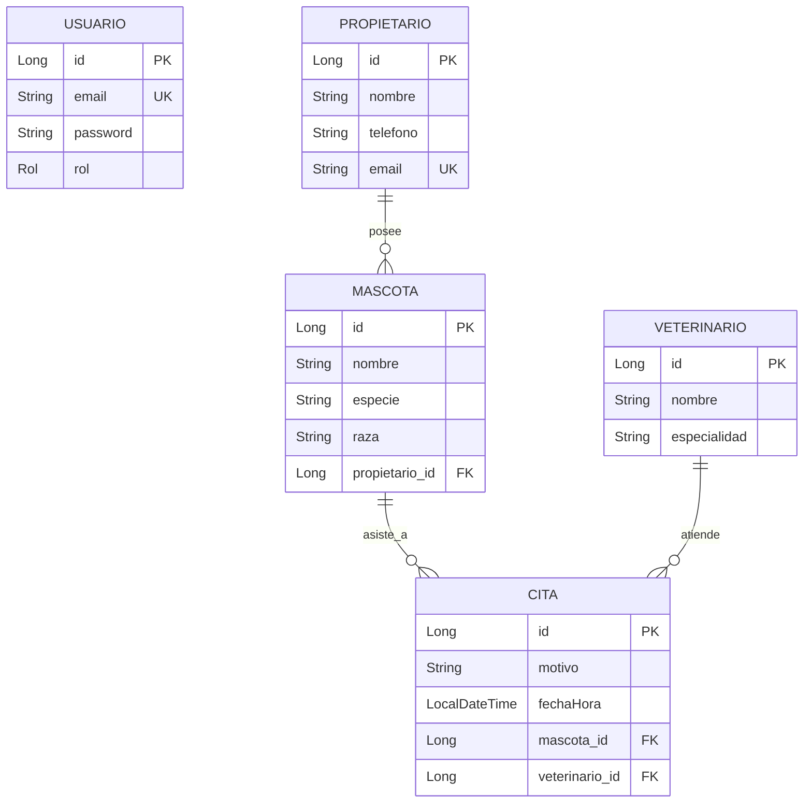

# 🐾 VetTurno - Sistema de Gestión de Turnos Veterinarios
*Veterinaria Huellitas API RESTful*


---

## 📖 Descripción del Proyecto

**VetTurno** es una API RESTful desarrollada con **Spring Boot** para la gestión integral de citas y turnos en clínicas veterinarias (*Veterinaria Huellitas*). 

Permite administrar de manera segura y centralizada:
- 👥 **Propietarios:** Registro e información de contacto de los tutores de mascotas.
- 🐶 **Mascotas:** Registro de pacientes caninos, felinos, etc., vinculados a su propietario.
- 🩺 **Veterinarios:** Personal médico y sus especialidades.
- 📅 **Citas Médicas:** Agendamiento inteligente con validación de disponibilidad y horarios futuros.
- 🔐 **Seguridad y Acceso:** Autenticación sin estado (*stateless*) mediante tokens **JWT** y control de roles (`USER` y `ADMIN`).

---

## 🧩 Modelo de Datos y Arquitectura



---

## ⚡ Reglas de Negocio Destacadas

1. **Horarios Futuros:** No es posible registrar citas en fechas pasadas (`fechaHora > now()`).
2. **Disponibilidad de Médicos:** No se permite que un mismo veterinario tenga más de una cita agendada en la misma fecha y hora exacta.
3. **Integridad Relacional:** Las mascotas deben pertenecer a un propietario existente, y las citas deben asociarse a mascotas y veterinarios válidos.
4. **Control de Acceso Basado en Roles (RBAC):**
   - El registro de nuevos veterinarios (`POST /api/veterinarios`) es exclusivo para usuarios con rol **`ADMIN`**.
   - El resto de operaciones de lectura y creación de citas/mascotas/propietarios están disponibles para **`USER`** y **`ADMIN`**.

---

## 🛠️ Tecnologías y Librerías

- **Lenguaje:** Java 17
- **Framework:** Spring Boot (Spring Web MVC, Spring Data JPA, Spring Security, Spring Validation)
- **Base de Datos:** MySQL
- **Autenticación:** JWT (JSON Web Tokens con librería `io.jsonwebtoken:jjwt`)
- **Documentación de API:** SpringDoc OpenAPI 3 / Swagger UI
- **Herramienta de Construcción:** Maven con Maven Wrapper (`mvnw`)

---

## 📋 Requisitos Previos

Asegúrate de tener instalado en tu equipo:
- [JDK 17+](https://adoptium.net/) (Java Development Kit)
- [MySQL Server](https://dev.mysql.com/downloads/mysql/) (v8.0 o superior)
- [Git](https://git-scm.com/) (opcional, para clonar el repositorio)
- [Postman](https://www.postman.com/) o [Insomnia](https://insomnia.rest/) (opcional, para probar peticiones HTTP)

---

## 🚀 Guía de Instalación y Ejecución Paso a Paso

### 1. Clonar o descargar el repositorio
```bash
git clone https://github.com/JeanEsg/vetTurno.git
cd vetTurno
```

### 2. Crear la Base de Datos en MySQL
Abre tu consola de MySQL o tu cliente preferido (MySQL Workbench, DBeaver, HeidiSQL) y crea la base de datos:

```sql
CREATE DATABASE db_vet_turno CHARACTER SET utf8mb4 COLLATE utf8mb4_unicode_ci;
```

> **Nota:** Hibernate creará y actualizará automáticamente todas las tablas (`spring.jpa.hibernate.ddl-auto=update`).

---

### 3. Configurar las Variables de Entorno

El proyecto lee la conexión de la base de datos a través de variables de entorno definidas en `application.properties`:
- `${DB_URL}`
- `${DB_USERNAME}`
- `${DB_PASSWORD}`

El proyecto ya cuenta con una plantilla en el archivo `.env`:

```properties
DB_URL=jdbc:mysql://localhost:3306/*nombre_de _tu_bd*
DB_USERNAME=tu_usuario_aqui
DB_PASSWORD=tu_password_aqui
```

#### Opciones para ejecutar con estas variables:

**Opción A: Ejecutar desde IntelliJ IDEA / Eclipse / VS Code**
- Configura las variables de entorno en tu Run Configuration:
  - `DB_URL` = `jdbc:mysql://localhost:3306/*nombre_de _tu_bd*`
  - `DB_USERNAME` = `root`
  - `DB_PASSWORD` = `tu_password_aqui`

**Opción B: Exportar en Terminal / PowerShell**
En **PowerShell (Windows)**:
```powershell
$env:DB_URL="jdbc:mysql://localhost:3306/*nombre_de _tu_bd*"
$env:DB_USERNAME="root"
$env:DB_PASSWORD="tu_password_aqui"
.\mvnw.cmd spring-boot:run
```

En **CMD (Windows)**:
```cmd
set DB_URL=jdbc:mysql://localhost:3306/*nombre_de _tu_bd*
set DB_USERNAME=root
set DB_PASSWORD=tu_password_aqui
mvnw.cmd spring-boot:run
```

En **Bash / Linux / Mac**:
```bash
export DB_URL=jdbc:mysql://localhost:3306/*nombre_de _tu_bd*
export DB_USERNAME=root
export DB_PASSWORD=tu_password_aqui
./mvnw spring-boot:run
```

**Opción C: Pasar parámetros directamente con Maven**
```powershell
.\mvnw.cmd spring-boot:run "-Dspring-boot.run.arguments=--spring.datasource.url=jdbc:mysql://localhost:3306/db_vet_turno --spring.datasource.username=root --spring.datasource.password=tu_password_aqui"
```

---

### 4. Verificar que la aplicación está en marcha
Una vez iniciado el servidor, verás en la consola:
```text
Tomcat started on port 8080 (http) with context path '/'
Started VetTurnoApplication in X.XXX seconds
```

---

## 🌐 Documentación Interactiva (Swagger UI)

Puedes visualizar, explorar y probar todos los endpoints directamente desde tu navegador:

👉 **URL de Swagger UI:** [http://localhost:8080/swagger-ui/index.html](http://localhost:8080/swagger-ui/index.html)

> 💡 **Para autorizar peticiones en Swagger:**
> 1. Haz login en `/api/auth/login` y copia el token generado.
> 2. Haz clic en el botón verde **Authorize 🔓** (arriba a la derecha).
> 3. Pega el token JWT y confirma. ¡Listo! Todas las solicitudes incluirán el header `Authorization: Bearer <token>`.

---

## 🧪 Flujo de Prueba Completo (Paso a Paso)

Sigue este orden lógico para probar todo el circuito de la veterinaria:

### Paso 1: Registrar un Usuario
`POST http://localhost:8080/api/auth/register`

**Body (JSON):**
```json
{
  "email": "admin@veterinaria.com",
  "password": "password123"
}
```

**Respuesta (200 OK):**
```json
{
  "token": "eyJhbGciOiJIUzI1NiJ9..."
}
```

> 💡 *Por defecto los usuarios se crean con rol `USER`.*

---

### Paso 2: Habilitar Rol ADMIN (Opcional, para crear veterinarios)
Si deseas registrar veterinarios vía API, cambia el rol de tu usuario en MySQL:

```sql
UPDATE usuarios SET rol = 'ADMIN' WHERE email = 'admin@veterinaria.com';
```

Vuelve a hacer login (`POST /api/auth/login`) para obtener un nuevo token con permisos de `ADMIN`.

---

### Paso 3: Iniciar Sesión (Login)
`POST http://localhost:8080/api/auth/login`

**Body (JSON):**
```json
{
  "email": "admin@veterinaria.com",
  "password": "password123"
}
```

Copia el `token` devuelto. En las siguientes peticiones añade la cabecera:
`Authorization: Bearer <TU_TOKEN>`

---

### Paso 4: Registrar un Veterinario (Requiere rol ADMIN)
`POST http://localhost:8080/api/veterinarios`  
`Authorization: Bearer <TOKEN>`

**Body (JSON):**
```json
{
  "nombre": "Dra. Laura Camila Torres",
  "especialidad": "Cirugía y Medicina Felina"
}
```

**Respuesta (201 Created):**
```json
{
  "id": 1,
  "nombre": "Dra. Laura Camila Torres",
  "especialidad": "Cirugía y Medicina Felina"
}
```

---

### Paso 5: Registrar un Propietario (Tutor)
`POST http://localhost:8080/api/propietarios`  
`Authorization: Bearer <TOKEN>`

**Body (JSON):**
```json
{
  "nombre": "Carlos Mendoza",
  "telefono": "+573001234567",
  "email": "carlos.mendoza@email.com"
}
```

**Respuesta (201 Created):**
```json
{
  "id": 1,
  "nombre": "Carlos Mendoza",
  "telefono": "+573001234567",
  "email": "carlos.mendoza@email.com"
}
```

---

### Paso 6: Registrar una Mascota
`POST http://localhost:8080/api/mascotas`  
`Authorization: Bearer <TOKEN>`

**Body (JSON):**
```json
{
  "nombre": "Max",
  "especie": "Perro",
  "raza": "Golden Retriever",
  "propietarioId": 1
}
```

**Respuesta (201 Created):**
```json
{
  "id": 1,
  "nombre": "Max",
  "especie": "Perro",
  "raza": "Golden Retriever",
  "propietarioId": 1,
  "propietarioNombre": "Carlos Mendoza"
}
```

---

### Paso 7: Agendar una Cita Médica
`POST http://localhost:8080/api/citas`  
`Authorization: Bearer <TOKEN>`

> ⚠️ **Importante:** La fecha debe ser posterior al momento actual (en formato ISO-8601: `YYYY-MM-DDTHH:mm:ss`).

**Body (JSON):**
```json
{
  "motivo": "Vacunación anual y control general",
  "mascotaId": 1,
  "veterinarioId": 1,
  "fechaHora": "2026-11-20T10:30:00"
}
```

**Respuesta (201 Created):**
```json
{
  "id": 1,
  "motivo": "Vacunación anual y control general",
  "mascota": "Max",
  "propietario": "Carlos Mendoza",
  "veterinario": "Dra. Laura Camila Torres",
  "fechaHora": "2026-11-20T10:30:00"
}
```

---

### Paso 8: Probar Validaciones del Negocio

1. **Intenta agendar otra cita para el mismo veterinario en el mismo horario:**
   - La API responderá con `400 Bad Request`:
   ```json
   {
     "status": 400,
     "mensaje": "El veterinario ya tiene una cita en ese horario",
     "errores": null
   }
   ```

2. **Intenta agendar una cita en una fecha pasada:**
   - La API responderá con `400 Bad Request`:
   ```json
   {
     "status": 400,
     "mensaje": "Los datos enviados no son válidos",
     "errores": {
       "fechaHora": "La cita debe ser futura"
     }
   }
   ```

---

## 📚 Catálogo Completo de Endpoints

| Método | Endpoint | Rol Requerido | Descripción |
| :--- | :--- | :--- | :--- |
| **POST** | `/api/auth/register` | Público | Registra un nuevo usuario (`USER`). |
| **POST** | `/api/auth/login` | Público | Inicia sesión y devuelve token JWT. |
| **GET** | `/api/veterinarios` | `USER`, `ADMIN` | Lista todos los veterinarios. |
| **POST** | `/api/veterinarios` | `ADMIN` | Registra un nuevo veterinario. |
| **GET** | `/api/propietarios` | `USER`, `ADMIN` | Lista todos los propietarios. |
| **POST** | `/api/propietarios` | `USER`, `ADMIN` | Registra un nuevo propietario. |
| **GET** | `/api/mascotas` | `USER`, `ADMIN` | Lista todas las mascotas con su propietario. |
| **GET** | `/api/mascotas/propietario/{propietarioId}` | `USER`, `ADMIN` | Lista las mascotas de un propietario específico. |
| **POST** | `/api/mascotas` | `USER`, `ADMIN` | Registra una nueva mascota vinculada a un propietario. |
| **GET** | `/api/citas` | `USER`, `ADMIN` | Lista todas las citas agendadas. |
| **GET** | `/api/citas/veterinario/{id}` | `USER`, `ADMIN` | Lista las citas asignadas a un veterinario específico. |
| **POST** | `/api/citas` | `USER`, `ADMIN` | Agenda una nueva cita (valida fecha futura y agenda libre). |

---

## 📂 Estructura del Código Fuente

```text
src/main/java/com/jeanEsguerra/vetTurno/
├── VetTurnoApplication.java     # Clase principal de Spring Boot
├── config/
│   └── OpenApiConfig.java       # Configuración de OpenAPI 3 / Swagger y esquema Bearer JWT
├── controller/                  # Controladores REST
│   ├── AuthController.java
│   ├── CitaController.java
│   ├── MascotaController.java
│   ├── PropietarioController.java
│   └── VeterinarioController.java
├── dto/                         # Data Transfer Objects (Requests y Responses)
│   ├── AuthResponse.java
│   ├── CitaDTO.java / CitaRequest.java
│   ├── LoginRequest.java / RegistroRequest.java
│   ├── MascotaDTO.java / MascotaRequest.java
│   ├── PropietarioDTO.java / PropietarioRequest.java
│   └── VeterinarioDTO.java / VeterinarioRequest.java
├── exception/                   # Manejador centralizado de errores
│   ├── ApiError.java
│   └── GlobalExceptionHandler.java
├── model/                       # Entidades JPA
│   ├── Cita.java
│   ├── Mascota.java
│   ├── Propietario.java
│   ├── Rol.java
│   ├── Usuario.java
│   └── Veterinario.java
├── repository/                  # Repositorios JPA con Spring Data
│   ├── CitaRepository.java
│   ├── MascotaRepository.java
│   ├── PropietarioRepository.java
│   ├── UsuarioRepository.java
│   └── VeterinarioRepository.java
├── security/                    # Configuración de seguridad Spring Security y JWT
│   ├── JwtAuthFilter.java       # Filtro interceptor de solicitudes HTTP
│   ├── JwtService.java          # Generación y validación de tokens JWT
│   ├── SecurityConfig.java      # Reglas de autorización de rutas y beans de cifrado
│   └── UsuarioDetailsService.java # Integración de usuarios con Spring Security
└── service/                     # Lógica de negocio
    ├── AuthService.java
    ├── CitaService.java
    ├── MascotaService.java
    ├── PropietarioService.java
    └── VeterinarioService.java
```

---

## 🛡️ Formato de Respuestas de Error

El proyecto implementa un manejador global de excepciones (`GlobalExceptionHandler`) que estandariza las respuestas en formato JSON para que el cliente siempre reciba información clara:

```json
{
  "status": 400,
  "mensaje": "Los datos enviados no son válidos",
  "errores": {
    "email": "El correo no tiene un formato válido",
    "password": "La contraseña debe tener al menos 6 caracteres"
  }
}
```

---

## 👨‍💻 Autor

- **Jean Esguerra**
- Proyecto: **VetTurno - Veterinaria Huellitas** (Módulo 3 - Backend Java & Spring Boot)
